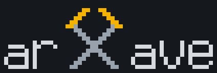
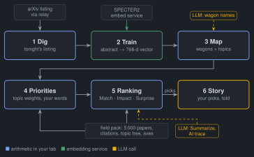
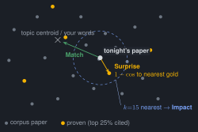
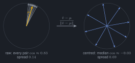

<p align="center">
  
</p>

<p align="center">
  <em>Cave dark. Gold small. Bring lamp.</em>
</p>

<p align="center">
  <a href="https://arxave.com/"><strong>Dig</strong></a> ·
  <a href="https://arxave.com/stockpile/">Stockpile</a> ·
  <a href="https://arxave.com/haul/">Haul</a> ·
  <a href="https://arxave.com/details/">Details</a>
</p>

---

## Why arXave exist

**arXiv is dark cave.** Every night mountain dump hundreds new rock at your feet.
No light. No label. You squat, you paw at pile with cold hand, you pick maybe
twenty by title. Rest go in dark forever.

**Somewhere in pile is gold.** The one paper that change what you build next
month. You walk past it. Never know. That is the real cost — not time wasted,
gold missed.

**And pile full of pyrite.** Fool's gold. Shiny, big name, big claim, look
exactly like gold in bad light. You carry it home, you spend three evening on it,
it worth nothing. Pyrite cost double: your evening, plus the real nugget you not
pick up because hand full.

**Hard part not reading. Hard part is finding.** Nugget rare, rock heavy, cave
big, night short.

arXave is lamp and sieve. It go down in cave every morning, wash whole night
pile, hold up the few stone that match *your* seam, and say out loud **why** each
one look like gold. Every rock it touch go in the bag — even one it throw back —
so nothing lost, and you can re-wash pile later when your seam change.

Two goal, only two:

1. **Never miss nugget that matter.**
2. **Bigger reading bandwidth** — more tunnel swept, same hours, less pyrite.

---


## How the Cave picks papers

No language model ranks anything. Every grade is a cosine, a percentile or a
z-score, and each one is below with the code that computes it and the paper it
comes from. The live version, with a stage explorer and a grade calculator, is
[Details](https://arxave.com/details/).

- [The six stages](#the-six-stages)
- [The grades](#the-grades)
- [The fields](#the-fields)
- [The geometry](#the-geometry)
- [What leaves your tab](#what-leaves-your-tab)
- [Not built yet](#not-built-yet)
- [Sources](#sources)

## The six stages

<p align="center">
  
</p>

Blue: arithmetic in your tab. Green: embedding. Gold: an LLM call, never in
the ranking. ([TikZ](docs/diagrams/cave-flow.tex))

| # | Stage | In → out | Rule | Code |
|---|---|---|---|---|
| 1 | **Dig** | categories, 1–7 publishing days → up to 1 000 abstracts | Publishing days, not calendar days: arXiv is silent on weekends. The first category picks the field. | [`cave-stage-dig.mjs`](docs/assets/cave-stage-dig.mjs) |
| 2 | **Train** | abstracts → 768-d SPECTER2 vectors, clipped ±0.25, centred on the field mean | Cached by text hash, so a warm night is a download, not a computation. | [`cave-train.mjs`](docs/assets/cave-train.mjs) |
| 3 | **Map** | vectors → wagons, plus one leaf topic (and a close runner-up) per paper | Average linkage; cut auto-picked in 0.40–0.75, slider 0.20–0.70; no wagon over 20% of the night. | [`cave-stage-map.mjs`](docs/assets/cave-stage-map.mjs) |
| 4 | **Priorities** | topic tree, your text → weights 1.5 / 1 / 0.5 / off; your words as vectors | Off removes a topic from the corpus too: no neighbours, no landmarks, no median. | [`cave-stage-priorities.mjs`](docs/assets/cave-stage-priorities.mjs) |
| 5 | **Ranking** | night + priorities → Match · Impact · Surprise · Exp. per paper, 5 at a time | No gate: Topic match is a weight on the order, not a filter that can empty the night. | [`cave-stage-ranking.mjs`](docs/assets/cave-stage-ranking.mjs) |
| 6 | **Story** | ≤ 12 picks → one narrative, cached per night + picks | The model's text is escaped first; only paper ids it was sent become links. | [`cave-stage-story.mjs`](docs/assets/cave-stage-story.mjs) |

## The grades

<p align="center">
  
</p>

One paper, three questions, one pass over the corpus.
([TikZ](docs/diagrams/cave-grades.tex))

| Grade | Raw value | Graded as | Code |
|---|---|---|---|
| **Match** | max cos to your words, else weighted mean cos to topic centroids | Φ(z), z vs corpus weighted median / MAD | `fitRaw`, `prepare` |
| **Impact** | citation percentile of the 15 nearest corpus papers, weighted cos⁺·(p+0.05) | Φ((x − μ)/σ), field's `promise_ref` | `rank` |
| **Surprise** | 1 − cos to nearest corpus paper with pct ≥ 0.75 | Φ((x − μ)/σ), field's `promise_ref` | `rank` |
| **Exp.** | logistic probe on the vector (96 train / 24 test, 92% held out) | 100 − P(theory) | `axisProbability` |
| **AI trace** | LLM's guess that the abstract is machine-written | its %, labelled a guess | `aitrace` fn |

The order on the Ranking card:

```
β       = 1.5·s − 1.25                 s = Surprise slider, 0…1
sd      = √(1 + β² + 2βρ)              ρ = corr(impact, novelty) in the corpus
Promise = Φ((z_impact + β·z_novelty) / sd)
Row bar = (1 − w)·Promise + w·Match − penalty     w = Topic match slider
```

The penalty is up to 30 points for a single-author paper, scaled by its slider.
Code: [`sieve-core.mjs`](docs/assets/sieve-core.mjs) (`promiseScore`, `phi`),
[`cave-stage-ranking.mjs`](docs/assets/cave-stage-ranking.mjs).

<details>
<summary>Why novelty counts <em>against</em> a paper at Surprise 50</summary>

Leave-one-out over the quantum corpus (each paper scored against the other 4 999):

| Signal vs own citation percentile | Spearman | AUC (top vs bottom quartile) |
|---|---|---|
| Impact | +0.28 | 0.67 |
| Novelty | −0.30 | 0.30 |
| old score (tonight's percentiles, ½ + ½) | — | 0.48 |
| Impact with novelty at β = −0.5 | — | **0.71** |

On average, papers far from everything else are the ones nobody cites.
Surprise 100 (β = +0.25) still lets you ask for them.

</details>

## The fields

Dig's **first** category picks the field: `cs.AI` first gives AI, `quant-ph`
first gives Quantum. A list holding both says so at load and offers the switch.

| | Quantum | AI |
|---|---|---|
| Categories | `quant-ph`, `cond-mat.mes-hall` | `cs.AI`, `cs.LG` |
| Corpus | 5 000 papers, Sep–Dec 2025 | 5 000 papers, Sep–Dec 2025 (top 2 500 cited + 2 500 random) |
| Topic tree | 12 leaves · 5 parents | 14 leaves · 6 parents |
| Seeds | 300 (25 per leaf) | 350 (25 per leaf, by title rules) |
| Leave-one-out seed recall | 0.927 | 0.926 |
| Impact μ / σ | 0.628 / 0.099 | 0.749 / 0.132 |
| Novelty μ / σ | 0.150 / 0.041 | 0.125 / 0.039 |
| ρ(impact, novelty) | −0.434 | −0.544 |
| Axes | Theory ↔ Experiment, ML for quantum | none yet |

A field is a whole pack (corpus, vectors, tree, axes), because a grade only
means something against its own background. Files:
[`docs/assets/corpus/`](docs/assets/corpus/),
[`cave-fields.mjs`](docs/assets/cave-fields.mjs).

## The geometry

<p align="center">
  
</p>

Subtract the corpus mean μ, renormalise.
([TikZ](docs/diagrams/cave-centre.tex))

| Pairwise cos (1 241 vectors, 2026-08-19) | p5 | p50 | p95 | spread |
|---|---|---|---|---|
| raw | 0.766 | 0.832 | 0.903 | 0.137 |
| centred | −0.300 | −0.030 | 0.385 | **0.685** |

SPECTER2 vectors share one direction (‖mean‖ = 0.913) [3, 4]. Centring does not
re-rank anything; it makes the ranking *readable*. Each field centres on its own
corpus mean, after the same int8 clip the corpus was stored with
(`corpusSpace`).

<details>
<summary>Topics, wagons and the clip, in one table</summary>

| Piece | Rule | Number |
|---|---|---|
| Topic of a paper | nearest leaf centroid; runner-up kept if within | 0.03 cos |
| Leaf centroid | mean of its seed papers | 25 seeds |
| Topic weights | Prefer / Equal / Avoid / Off | 1.5 / 1 / 0.5 / excluded |
| Wagons | average linkage on the cos matrix [7] | cut 0.20–0.70, auto-picked |
| Largest wagon | capped so no blob swallows the night | ≤ 20% (floor 12) |
| Corpus clip | every component clamped before centring | ±0.25 (int8) |
| Match z | weighted median and 1.4826·MAD [6] | robust to one outlier |

</details>

## What leaves your tab

| Call | Sends | Model | When |
|---|---|---|---|
| `relay` | category, date range | — | Dig |
| `embed` | abstracts; your Priorities box | SPECTER2 [1, 2] | Train; typing (600 ms debounce) |
| `wagon-name` | titles only | Gemini flash-lite | Map, on the button |
| `diamond` | one paper | DeepSeek V4.1 Flash (default) | Ranking → Summarize |
| `aitrace` | abstracts on screen | DeepSeek V4.1 Flash (default) | Ranking → AI trace button |
| `story` | ≤ 12 picks | DeepSeek V4.1 Flash (default) | Story |

Abstracts are cached by text hash so nobody pays twice. **What you type is
never cached.** Everything else (weights, picks, stories) lives in your
browser's storage. The functions are in
[`supabase/functions/`](supabase/functions/).

## Not built yet

| | Status |
|---|---|
| Haul, Stockpile | greyed out in the bar while the Cave is rebuilt |
| Discuss threads | button greyed; GitHub Discussions wiring parked |
| AI-field axes | no Theory ↔ Experiment probe for AI yet |
| Bring your own LLM key | not on the page |
| Command-line pipeline | older, separate design in [`src/arxave/`](src/arxave/) |

## Sources

1. Singh et al., *SciRepEval: A Multi-Format Benchmark for Scientific Document Representations*, EMNLP 2023. [arXiv:2211.13308](https://arxiv.org/abs/2211.13308) (SPECTER2)
2. Cohan et al., *SPECTER: Document-level Representation Learning using Citation-informed Transformers*, ACL 2020. [arXiv:2004.07180](https://arxiv.org/abs/2004.07180)
3. Ethayarajh, *How Contextual are Contextualized Word Representations?*, EMNLP 2019. [arXiv:1909.00512](https://arxiv.org/abs/1909.00512) (the cone)
4. Mu & Viswanath, *All-but-the-Top: Simple and Effective Postprocessing for Word Representations*, ICLR 2018. [arXiv:1702.01417](https://arxiv.org/abs/1702.01417) (subtract the mean)
5. Priem, Piwowar & Orr, *OpenAlex: A fully-open index of scholarly works*, 2022. [arXiv:2205.01833](https://arxiv.org/abs/2205.01833) (the corpus' citation counts)
6. Leys et al., *Detecting outliers: Do not use standard deviation around the mean, use absolute deviation around the median*, J. Exp. Soc. Psychol. 49 (2013). [doi](https://doi.org/10.1016/j.jesp.2013.03.013) (MAD × 1.4826)
7. Lance & Williams, *A general theory of classificatory sorting strategies: 1. Hierarchical systems*, Comput. J. 9 (1967). [doi](https://doi.org/10.1093/comjnl/9.4.373) (average linkage update)
8. arXiv, [API documentation](https://info.arxiv.org/help/api/) (the nightly listing)

Every number here is a property of one model on one archive, and is dated or
reproducible: `scripts/cave-promise-ref.mjs`, `scripts/cave-topics.mjs`,
`scripts/measure-centroid.mjs`.

---

Want to help? See [CONTRIBUTING.md](CONTRIBUTING.md).
